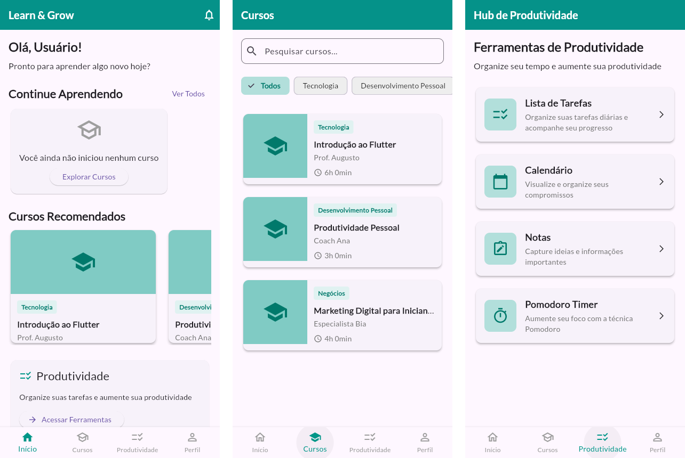

# 📚 Learn & Grow

Aplicativo Flutter de estudos e produtividade: cursos, lista de tarefas, calendário de eventos e anotações em um só lugar, com tema claro e escuro.

<p align="center">
  
</p>

## Funcionalidades

- **Splash e login/cadastro** com validação de formulário (autenticação simulada)
- **Cursos**: lista, detalhes e progresso de cada curso
- **Tarefas**: criar e marcar tarefas como concluídas
- **Calendário**: eventos por dia com `table_calendar`, incluindo eventos de dia inteiro
- **Notas**: criar, editar e excluir anotações
- **Hub de produtividade** reunindo as ferramentas
- **Perfil** com alternância de tema escuro, salva com `shared_preferences`
- Navegação inferior entre as seções principais

Os dados de cursos, eventos e notas vêm de arquivos de exemplo em `lib/data/`. Ainda não há backend.

## Tecnologias

- Flutter e Dart 3
- [provider](https://pub.dev/packages/provider) para estado do tema
- [shared_preferences](https://pub.dev/packages/shared_preferences) para preferências locais
- [table_calendar](https://pub.dev/packages/table_calendar) e [google_fonts](https://pub.dev/packages/google_fonts)

## Como executar

Com o [Flutter](https://docs.flutter.dev/get-started/install) 3.35 ou mais recente instalado:

```bash
flutter pub get
flutter run
```

Para rodar os testes:

```bash
flutter test
```

## Estrutura

```
lib/
  data/       dados de exemplo (cursos, eventos, notas)
  models/     modelos Course, Task, Event e Note
  providers/  ThemeProvider (tema claro/escuro)
  screens/    telas do app
  widgets/    componentes reutilizáveis
```

## Licença

[MIT](LICENSE)
